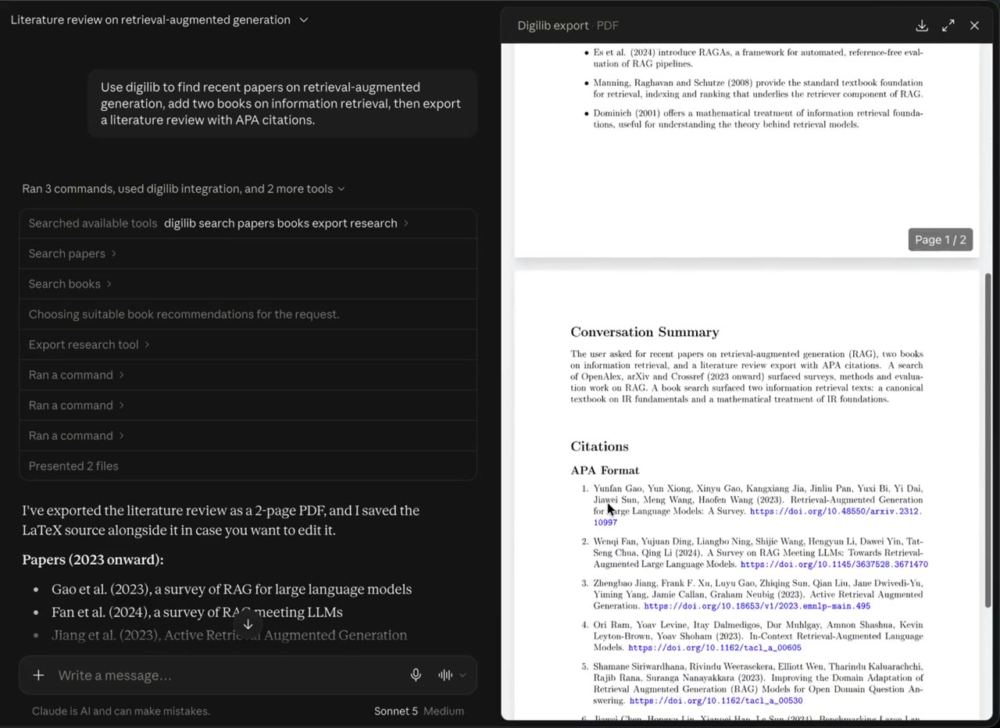

<div align="center">

# digilib-mcp

[](https://www.python.org/)
[](https://modelcontextprotocol.io)
[](#sources)
[](#configuration)
[](#configuration)
[](#license)

**DigiLIB** stands for **digital librarian** — and this MCP server gives that
ability to the agent of choice. Connect it to any MCP-capable agent (Claude
Code, Claude Desktop, Codex, Antigravity, Cursor, OpenCode, and more) and
that agent becomes a librarian: search academic papers and books across six
free sources, and export a cited literature review as LaTeX.

No API keys. No paid services. No frontend. No TeX dependency.

</div>

## Demo

<p align="center">
  <a href="demo/connect-to-claude.mp4">
    
  </a>
</p>

<p align="center"><a href="demo/connect-to-claude.mp4">▶ Watch the recording</a> (1.5 minutes)</p>

digilib running in Claude Desktop. The prompt asks for recent papers on
retrieval-augmented generation, two books on information retrieval, and a
literature review with APA citations. Claude calls `search_papers`,
`search_books` and `export_research_tool`, then presents the review as both a
PDF and its LaTeX source.

## Quick start

### 1. Run it (no install, no keys)

```bash
uvx --from git+https://github.com/cars3/digilib-mcp digilib-mcp
```

`uvx` fetches and runs the server on demand — nothing to install, nothing to
configure. Python 3.10+ (verified on 3.12 and 3.14 with the `mcp` 2.x SDK).
Or run it from a checkout:

```bash
git clone https://github.com/cars3/digilib-mcp.git
cd digilib-mcp
python -m venv .venv
source .venv/bin/activate            # Windows: .venv\Scripts\activate
pip install -r requirements.txt
python -m digilib_mcp.server
```

### 2. Connect your agent

digilib registers as a standard stdio MCP server. Most clients accept:

```json
{
  "mcpServers": {
    "digilib": {
      "command": "uvx",
      "args": ["--from", "git+https://github.com/cars3/digilib-mcp", "digilib-mcp"]
    }
  }
}
```

Claude Code one-liner:

```bash
claude mcp add digilib -- uvx --from git+https://github.com/cars3/digilib-mcp digilib-mcp
```

One-page guides with each agent's exact config file and snippet live in
[docs/agents/](docs/agents/): Claude Code, Claude Desktop, Codex,
Antigravity, Cursor, OpenCode, Windsurf, Qwen Code, Kimi, Grok, Copilot CLI,
Pi, Hermes, legacy Gemini CLI — and a
[generic guide](docs/agents/generic.md) for any other MCP client.

### 3. Ask

> "Search the literature on retrieval-augmented generation, pull two books
> on information retrieval, and export a literature review with APA
> citations."

The agent calls the tools — and if it supports skills, it follows the
bundled digilib skill automatically.

## What it exposes

**Tools**
- `search_papers(keywords, year_from?, year_to?, size?)` — OpenAlex + arXiv + Semantic Scholar + Crossref
- `search_books(keywords, size?)` — Open Library + Google Books
- `export_research_tool(conversation_summary, literature_recommended, liked_articles?, citation_formats?)` — builds and returns the LaTeX source; the calling LLM renders it

**Prompt / Resource** (system-prompt delivery)
- `digilib_researcher` prompt → the DigiLIB persona system prompt
- `digilib://prompts/researcher` resource → same, for resource-based clients

<details>
<summary><strong>Arguments, in full</strong></summary>

<br>

**`search_papers`**

| Argument | Type | Meaning |
|---|---|---|
| `keywords` | `list[str]` | Key terms, e.g. `["transformer attention"]`. Pass 2-5 focused queries — the calling agent writes them |
| `year_from` / `year_to` | `int` | Restrict by publication year. Applied by OpenAlex and Crossref only |
| `size` | `int` | Results per source per keyword. Default `10`, max `40` |

**`search_books`**

| Argument | Type | Meaning |
|---|---|---|
| `keywords` | `list[str]` | Key terms; broader, book-friendly phrasing works best |
| `size` | `int` | Results per source per keyword. Default `10` |

**`export_research_tool`**

| Argument | Type | Meaning |
|---|---|---|
| `conversation_summary` | `str` | Plain-text summary of the conversation, written by the calling LLM |
| `literature_recommended` | `list[str]` | One line per bullet in the Literature Review section. A single multi-line string is also accepted |
| `liked_articles` | `list[dict]` | Citation entries with `title`, `authors`, `year`, `link` keys (capitalised keys work too) |
| `citation_formats` | `list[str]` | Any of `"APA"`, `"Chicago"`, `"MLA"` |

</details>

<details>
<summary><strong>What a search result looks like</strong> (abridged, illustrative)</summary>

<br>

Both search tools return a numbered plain-text list. The header echoes the queries that were actually sent and how many hits each source contributed.

```
Paper search results for: transformer attention (per-source hits: openalex=10, arxiv=10, semantic_scholar=9, crossref=10)
1. Attention Is All You Need
   Authors: Ashish Vaswani, Noam Shazeer, ...
   Year: 2017
   Type: preprint | Source: arxiv
   Link: https://arxiv.org/abs/...
   Abstract: The dominant sequence transduction models are based on ...
```

`DOI` and `Citations` are appended to the `Type` line when a source provides them. Abstracts are trimmed to 300 characters.

</details>

## How it works

```
calling agent → writes 2-5 focused search queries
                (the bundled digilib skill guides this)
              → PaperService / BookService fan out concurrently across sources
              → results normalized, deduplicated by title, returned as text
              → the agent synthesizes; can call export_research_tool to get
                the LaTeX source for the whole review
```

Every query goes to every source, each with a 15-second timeout, and a
source that fails simply contributes nothing — the per-source hit counts in
the result header show which. Duplicates are matched on lower-cased title,
first occurrence wins.

The calling agent is the intelligence here: it writes the queries, reads
the results, and does the synthesis. digilib is the librarian's toolkit.

## For AI agents

This repository carries native instructions for coding agents:

- `AGENTS.md` — the canonical guide, imported by `CLAUDE.md`, `CODEX.md`,
  `OPENCODE.md`, and `KIMI.md`
- `.agents/skills/digilib/SKILL.md` — the canonical skill, symlinked into
  `.claude/`, `.antigravitycli/`, `.grok/`, `.kimi/`, `.opencode/`, and
  `.qwen/` so every CLI auto-discovers it
- `docs/agents/` — per-agent connection guides

Open this repo in your agent of choice, and it will know how to set digilib
up.

## Configuration

Set in `.env` (auto-loaded, gitignored) at the repo root or inside
`digilib_mcp/` — see `.env.example`. **Every setting is optional**: with no
configuration at all, all six sources work keyless.

| Var | Default | Purpose |
|---|---|---|
| `DIGILIB_TRANSPORT` | `stdio` | `stdio` (desktop/CLI clients) or `streamable-http` |
| `DIGILIB_OPENALEX_EMAIL` | *(unset)* | Optional polite-pool contact for OpenAlex (better rate limits) |
| `DIGILIB_GOOGLE_BOOKS_API_KEY` | *(unset)* | Optional Google Books key for reliable quota |
| `DIGILIB_HOST` | `0.0.0.0` | Bind address, `streamable-http` only |
| `PORT` / `DIGILIB_PORT` | `8000` | Bind port, `streamable-http` only. `PORT` wins, so hosts that inject it just work |
| `DIGILIB_GATEWAY_TOKEN` | *(unset)* | Shared secret for the HTTP gateway. **Set this when hosting publicly** — see [Securing the gateway](#securing-the-gateway) |
| `DIGILIB_ALLOWED_HOSTS` | *(unset)* | Comma-separated `Host` allow-list for the HTTP gateway, e.g. `example.com,*.example.com`. When unset, the SDK's Host-header check is disabled so the server works behind a reverse proxy (otherwise: `421 Invalid Host header`). `streamable-http` only |

The `digilib_mcp/` folder is checked for `.env` first, and real environment
variables always win over the file.

Variable names must match exactly. A misspelled name (say
`DIGILIB_BOOKS_APIKEY` instead of `DIGILIB_GOOGLE_BOOKS_API_KEY`) is silently
ignored, and the feature behaves as if the key were never set.

## Run

```bash
# stdio (default — for desktop and CLI clients)
uv run python -m digilib_mcp.server

# HTTP (for remote agents)
DIGILIB_TRANSPORT=streamable-http uv run python -m digilib_mcp.server
```

Inside an activated virtualenv, plain `python -m digilib_mcp.server` works the
same way; the installed console script is `digilib-mcp`. A stdio server run
by hand just waits for input; it is meant to be launched by an MCP client.

## Exporting research

`export_research_tool` returns LaTeX source and does not render a PDF. The
calling LLM should save it as a `.tex` file (e.g. `digilib_export.tex`) and,
if `pdflatex` is available, compile it:

```bash
pdflatex -interaction=nonstopmode digilib_export.tex
```

Without a TeX install, keep the `.tex` file and compile it anywhere, such as
[Overleaf](https://www.overleaf.com/).

The document is a 12pt A4 article titled *DigiLIB Research Export*, with a
Literature Review (one bullet per recommended line), a Conversation Summary,
and a Citations section with one numbered list per requested format (APA,
Chicago, MLA). Special LaTeX characters such as `&`, `%` and `_` are escaped.

## Hosting as an HTTP gateway (Railway / Render / Fly)

Set `DIGILIB_TRANSPORT=streamable-http` and let the platform inject `PORT` —
the server binds `0.0.0.0` and serves the MCP endpoint at `/mcp`. The
included `Procfile` (`web: python -m digilib_mcp.server`) makes Railway
zero-config: connect the repo, set the env vars, deploy, generate a domain.

Point a remote MCP client at `https://<your-service>.up.railway.app/mcp`:

```bash
claude mcp add --transport http digilib https://<your-service>.up.railway.app/mcp
```

…or in `.mcp.json`:

```json
{
  "mcpServers": {
    "digilib": {
      "type": "http",
      "url": "https://<your-service>.up.railway.app/mcp"
    }
  }
}
```

## Securing the gateway

The streamable-http transport has **no built-in authentication**. If you host
it on a public URL without locking it down, anyone who finds the URL can call
the tools. This repo ships a shared-secret bearer gate that fixes that.

**1. Generate a token and set it as `DIGILIB_GATEWAY_TOKEN`:**
```bash
python -c "import secrets; print(secrets.token_urlsafe(32))"
# e.g. pK7x...long...string
```
Add it to your hosting env vars (Railway → Variables). When the token is set,
the server requires every request to carry `Authorization: Bearer <token>`;
without it, requests get `401`.

**2. Have clients send the token.** In `.mcp.json`:
```json
{
  "mcpServers": {
    "digilib": {
      "type": "http",
      "url": "https://<your-service>.up.railway.app/mcp",
      "headers": { "Authorization": "Bearer <your-token>" }
    }
  }
}
```

If `DIGILIB_GATEWAY_TOKEN` is **unset**, the server prints a loud warning and
runs unauthenticated — fine for local/LAN testing, not for a public URL.

> For **multi-user** or third-party-client access, this shared secret isn't
> enough — use the MCP SDK's native OAuth 2.1 resource-server support instead
> (`MCPServer(settings=Settings(auth=AuthSettings(...)), token_verifier=...)`),
> which wires up `BearerAuthBackend` + `RequireAuthMiddleware` and exposes the
> OAuth protected-resource metadata endpoints.

## Troubleshooting

- **The agent doesn't show digilib.** Check your agent's guide in
  [docs/agents/](docs/agents/) — the config paths differ per agent, and some
  need an absolute path to `uvx`. Most clients only read their config at
  launch, so restart the agent after editing.
- **A source shows `=0` in the result header.** Each source fails
  independently and quietly, so the header is where to look. Semantic Scholar
  returns 429s without a key, and Google Books shares a small daily quota
  unless `DIGILIB_GOOGLE_BOOKS_API_KEY` is set.
- **Google Books stays at 0 even with a key.** Check the variable name is
  exactly `DIGILIB_GOOGLE_BOOKS_API_KEY`.
- **Results feel thin.** Query quality matters — ask for more specific terms,
  or let the bundled skill guide the agent's query crafting (expand acronyms,
  add synonyms).
- **`421 Invalid Host header` over HTTP.** The request's `Host` isn't allowed.
  Leave `DIGILIB_ALLOWED_HOSTS` unset, or add your domain to it.

## Sources

| Source | Coverage | Key |
|---|---|---|
| OpenAlex | All disciplines | none (optional mailto for polite pool) |
| arXiv | Physics, CS, math, stats preprints | none |
| Semantic Scholar | All disciplines, citations | none (rate-limited) |
| Crossref | DOI registry, publisher metadata | none |
| Open Library | Books | none |
| Google Books | Books | none (basic search; key optional for quota) |

Notes:

- **OpenAlex** returns only records that have abstracts, and applies the year filters.
- **arXiv** is fetched with `requests`, because its edge WAF rejects `httpx` with a 406.
- **Semantic Scholar** gets one retry, with backoff, on a 429, and has no year filter.
- **Crossref** is limited to journal articles, has JATS markup stripped from abstracts, and applies the year filters.
- **Open Library** uses a book's first sentence as the abstract, else its subject tags.

## License

MIT — see [LICENSE](LICENSE).

## Credits

- DigiLIB — short for digital librarian — is the persona and capability layer
  this server provides; it lives in `digilib_mcp/context/researcher.md`.
- Data comes from [OpenAlex](https://openalex.org), [arXiv](https://arxiv.org),
  [Semantic Scholar](https://www.semanticscholar.org),
  [Crossref](https://www.crossref.org), [Open Library](https://openlibrary.org)
  and [Google Books](https://books.google.com).
